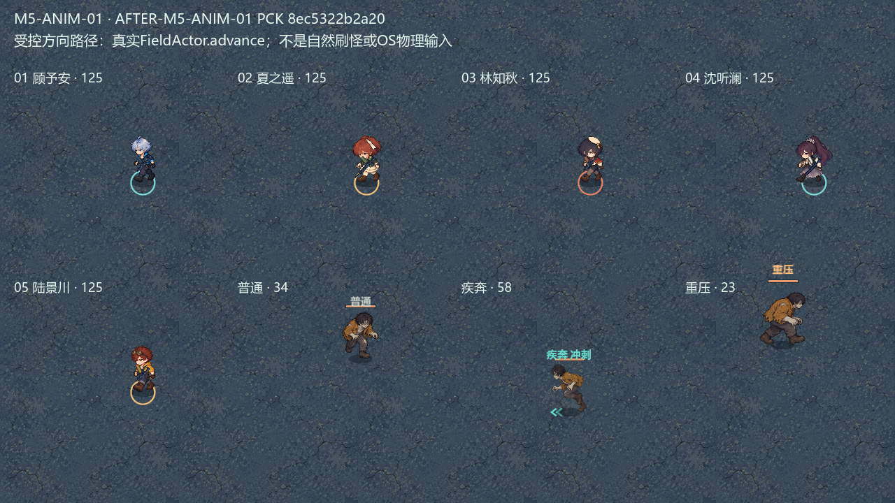
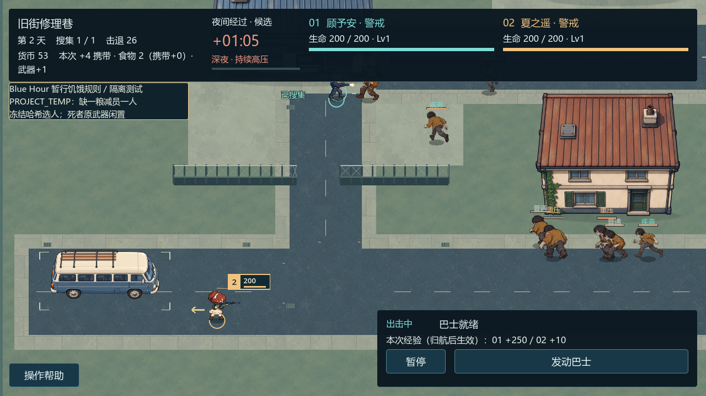
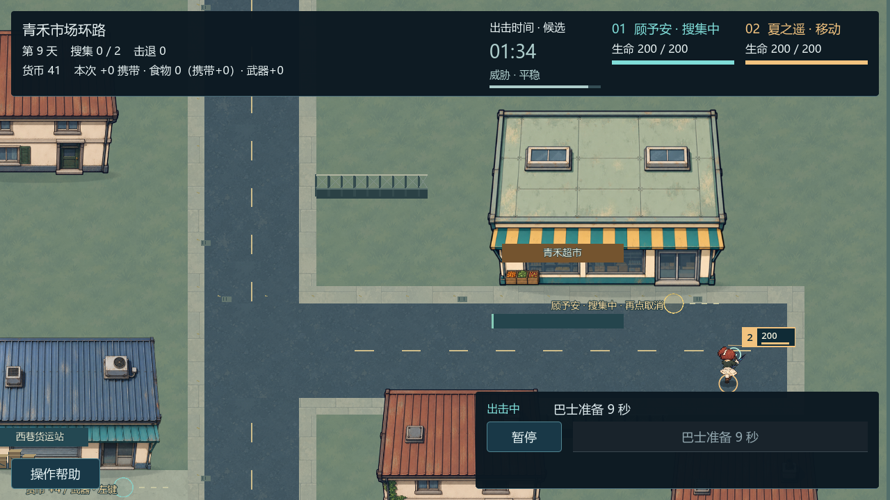
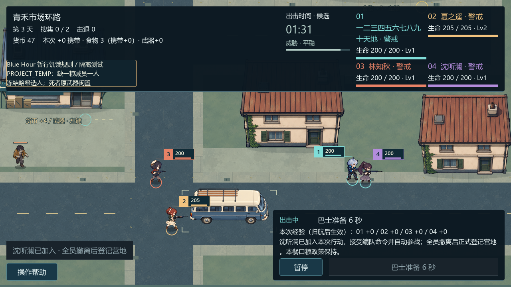

# 蓝时归航 · Blue Hour

Godot 2D 单机生存开发试玩。带领幸存者穿过街区，搜集物资、守住队友，再集合至巴士归航。

**M6-PLAYABLE-01：正常启动即可连续试玩，保留 ANIM-02、感染者V1与接触修复。不是正式发行版。** 动画阶段为 GO-ANIM-PILOT；正式生存发布门禁为 **BLOCKED / NO-GO-PRODUCTION**。精确收据传输候选修复已知极小浮点写盘回读的因果，仍待完整审阅；不要用本原型承载唯一的重要进度。

[ANIM-02](docs/design/m5-anim-02.md)保留普通感染者转向、短停步态和贴身偏移的连续性；[普通感染者V1](docs/design/m5-art-infected-01.md)使用五个独立源方向、三向镜像和六姿态步行。[M5-CONTACT-01](docs/design/m5-contact-01.md)新增逻辑脚点分离、追击留距和队友让位。本轮先交Mac证据，Windows-NOT-VERIFIED；此前Windows结果仅属于各自历史版本。物理输入与显示流畅性仍待验，2.5D身体遮挡仍允许。



这是M5-ANIM-01历史受控方向展示，使用真实角色路径，并非当前V1或自然刷怪。图片场景和条件见[截图说明](docs/screenshots/README.md)。

## 当前能做什么

正常启动选择「开始试玩」，进入营地、训练或配装，再从巴士选择任务；搜刮/救援后发动巴士并集合存活者，预览并确认结算，回营再次出击。下一次启动选择「继续试玩」。三次出击是验收样例，不是通关规则。

默认使用固定的 `user://playable-v1/run.enemy-v1.json` 独立进度。Mac位于 `~/Library/Application Support/Godot/app_userdata/Blue Hour - 蓝时归航/playable-v1/`。不会自动读取、迁移、覆盖或回退旧进度。以下既有系统通过统一入口接入，没有另一套玩法实现。

- 双街区真实寻路、墙体LOS、自动战斗、搜集与巴士全员集合。
- 单图一个救援目标，多个原创候选；确认后当场入队、交战和归航。
- 最多四名存活者，历史名册可保留五人；真实阵亡后可救援剩余候选补位，死者历史不复活。
- 本人普通XP、Trait与食物训练，营地档案、维修、配装和跨进程营地保存。
- 卡宾与长管的基础差异，独立武器实例、品质、武器等级和首批有效词条。
- 普通、疾奔、重压三类敌人及四阶段夜间混合增援；重压攻击有可规避的真实前摇。
- 五种幸存者的八方向移动/瞄准，以及持枪、移动射击、受击、倒地；敌人独立姿态与部分明确镜像。

以上人数、数值和素材均为 **PROJECT_TEMP**。夜间自然压力仍待平衡，动画仍有共帧、离散转向和贴身遮挡。查看[已知限制](docs/KNOWN_LIMITATIONS.md)及[功能与入口](docs/features/README.md)。



## 运行与可复测检查

固定 Godot **4.7.2.stable.official.ed1daf0bf**，Compatibility 渲染器；Python 3.10+，资源检查另需 Pillow。发布前另覆盖计划发布平台；M6按当前Mac范围验收，物理键鼠和人工观感仍未签核，详见[验证层级](docs/VALIDATION.md)。把引擎加入PATH，或使用 `--godot` / `GODOT_BIN` 指定本机引擎。

```powershell
python -m pip install Pillow==12.3.0
python tools/godot.py check --godot <引擎可执行文件>
python tools/godot.py run --godot <引擎可执行文件>
```

公开 `check` 是不依赖私有原件的复测子集：导入、默认及111主场景启动、战斗/导航/动作组件、普通感染者稳定性与V1资源检查。单float诊断保留原引擎 JSON 二周期，同时要求新编码十次真实磁盘往返稳定；另有 80 项精确编码和混合链回归。Windows 合成安全矩阵驱动随源码提供，结果及未验项按本轮证据报告；检查退出0不代表通过生产发布门禁，完整内部历史档不作为公共克隆已测。详见[验证边界](docs/VALIDATION.md)。

默认运行无需玩法参数，进度保存在上面的固定用户目录。开发检查仍可显式使用隔离111入口：

```powershell
python tools/godot.py run --enemy-trial --profile .local/demo --godot <引擎可执行文件>
```

后续使用同一目录并在游戏内选择继续。`check` 和显式 `--profile` 使用项目本地隔离目录，默认 `run` 使用固定试玩目录。旧双人开发入口为 `run --legacy-entry`；不要复制自己的真实进度做测试。旧途中暂存跨版本不能无条件读取。源码不含游戏安装包、Release或可下载EXE；可用已安装匹配导出模板的Godot编辑器自行导出。


## 五篇独立功能说明

| 文档 | 玩家流程与当前边界 |
| --- | --- |
| [出击、搜集与救援](docs/features/sortie-and-scavenging.md) | 双地图派工、取消、单目标候选救援及当场入队 |
| [战斗、视线与夜间](docs/features/combat-and-night-pressure.md) | 三敌种、两枪比较、真实LOS与八方向原型 |
| [巴士发动与撤离](docs/features/bus-evacuation.md) | 显式集合、实际全员到齐、结果预览和提交 |
| [营地、名册与配装](docs/features/camp-and-loadouts.md) | 四活五历史、普通成长/Trait/训练、武器实例与有效值 |
| [保存与恢复](docs/features/save-and-recovery.md) | 新旧档保护、一次暂存、精确收据与途中兼容边界 |

## 玩法展示与历史版本



**M5-COMBAT-03（edf9bd9）历史游戏截图**：正常市场搜集，不代表当前动画、成长或枪械值。



**M5-RESCUE-02历史游戏截图**：沈听澜当场加入四人行动，旧动作/HUD；呼号为人工压力测试，不是当前M5-ANIM-01截图。

营地、配装、巴士与结算等全部版本/来源和SHA见[截图索引](docs/screenshots/README.md)。仓库既有四张M5-ANIM-01图保持原字节，当前原型说明以功能文档为准。

## 开发效率工具

按实际改动与受影响合同选择当前系统检查，不因普通玩法涉及战斗自动运行完整存档矩阵。阶段计时工具仍可用，仅在工具改动时验其自身。

```powershell
python -m unittest discover -s tests/tools -p test_task_timing.py -v
python tools/task_timing.py --help
```

[执行规范](docs/development/codex-execution-efficiency.md) · [任务模板](docs/development/codex-task-template.md)

工具只记录显式可见区间，隐藏推理/完整对话耗时保持UNKNOWN；实际计时文件不随源码公开。计时工具不修改游戏或存档协议；精确收据传输另见[保存边界](docs/features/save-and-recovery.md)，正式生存NO-GO/BLOCKED。

## 操作与资料

左键地面移动、点建筑派工/取消；WASD移动镜头，滚轮缩放，空格暂停，Esc打开暂停菜单。发动巴士后仍需明确集合，全部实际存活者到达才归航。营地设施管理成员、物资、武器和训练。

[文档导航](docs/README.md) · [公开状态](docs/plan.md) · [架构](docs/architecture.md) · [素材来源](docs/ASSET_PROVENANCE.md)

代码、美术、声音独立制作；部分原创图像使用AI辅助生成，音效由数学合成。机制研究参考经典 Deadly Days，但不包含其素材、研究原件或私人证据，不声称精确复刻。当前没有 LICENSE，公开可见不等于授予外部复制、分发或商业复用许可。
