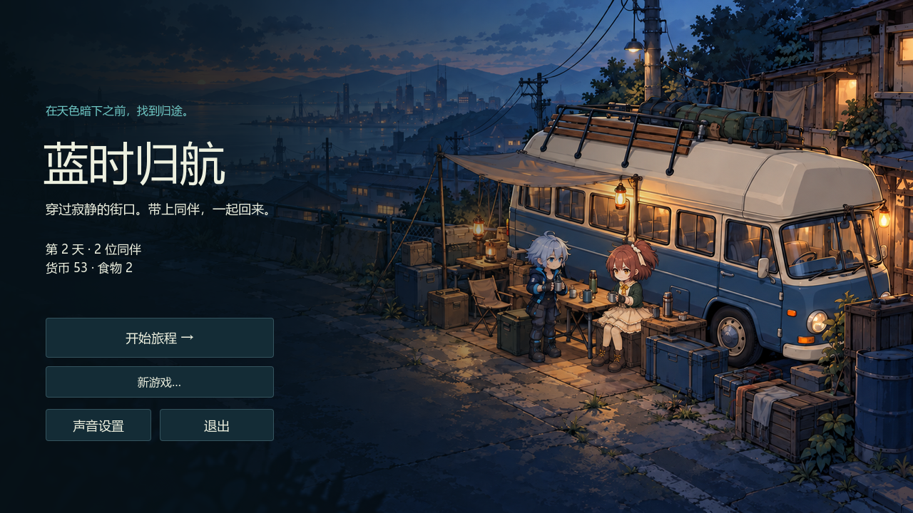
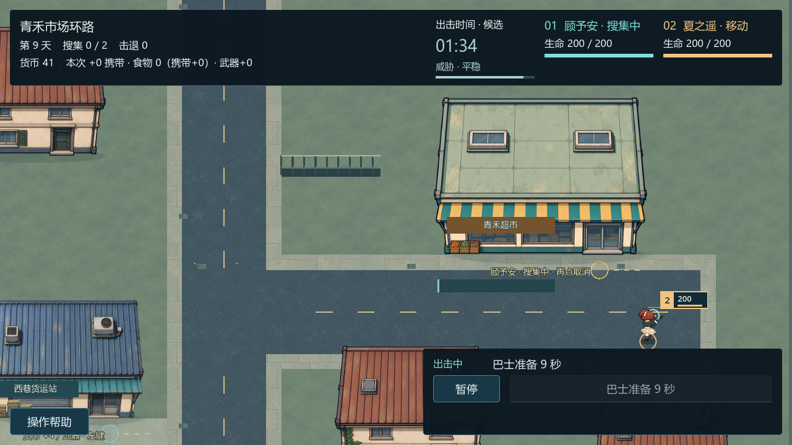

# 蓝时归航 · Blue Hour

一款独立制作的 Godot 2D 生存 Roguelite。带领顾予安与夏之遥穿过街区，在搜集物资、守住队友和及时归航之间作出选择。



首页图来自 M4-03 的首次进入状态，保留原始画面。全部选图的版本与场景见[截图说明](docs/screenshots/README.md)。

## 当前能玩什么

从营地选择修理巷或青禾市场，指派一人搜集，让另一人警戒或移动交火；带上钱粮和损坏武器，发动巴士，再明确下令集合。回到营地后结算一次，维修、配装、查看行动记录，并保存到下一次启动。

- 实际敌人 AI、寻路、攻击与受击；建筑挡住枪线，绕角后恢复合法开火。
- 青禾市场货运站附近有短视距侧路。继续驻守可能遭到近战；及时取消搜集并移动、集合或撤离可以避险。
- 逗留越久，普通敌人的增援间隔越短。暂停冻结世界，但仍可安排下一步行动。
- 发动巴士不会自动召回人员；集合人数来自实际位置，集合命令不会打断正在搜集的工人。
- 武器按实例保存；呼号、伤情、战绩和真实行动记录可跨进程恢复。



这是内容基线 `edf9bd9` 的公开候选快照，不包含之后的 P0 公共基础开发。当前只有两张固定原创地图、两名正式角色和两种武器。经验升级、特性效果、食物训练与正式永久死亡尚未开放，也没有完整随机城镇或整局进程恢复。

## 开始运行

当前验证目标是 Windows x86_64，使用 Godot **4.7.2.stable.official.ed1daf0bf** 与 Compatibility 渲染器；完整版本锁见 [.godot-version](.godot-version)。其他操作系统和跨机器兼容性没有在此候选中验收。

开发工具需要 Python 3.10+；图像校验额外需要 Pillow，游戏运行本身不依赖 Python。将固定版本引擎加入 PATH（命令名 `godot` 或 `godot4`），或把 `GODOT_BIN` 设置为本机引擎可执行文件。所有 Godot 入口也接受 `--godot` 参数。

在项目根目录执行：

```powershell
python -m pip install Pillow==12.3.0
python tools/godot.py check
python tools/godot.py run
```

先执行 `check` 完成导入和回归检查。也可用固定版本 Godot 项目管理器导入 [project.godot](project.godot)。运行时有已有进度先选择“继续游戏”；新游戏遇旧档会要求确认。

若要自行构建 Windows 程序，先安装匹配的 Windows x86_64 debug/release 导出模板，再执行：

```powershell
python tools/godot.py export
```

产物写到本地 `builds/windows`；启动 EXE 时保留相邻 PCK。本仓库当前没有已发布的 Windows 安装包、Release 或下载链接，构建产物不进入源码树。

## 基本操作

| 操作 | 输入 |
| --- | --- |
| 移动编队 | 左键可通行地面 |
| 指派 / 取消搜集 | 左键可搜集建筑，再点同一建筑取消 |
| 暂停 / 继续 | 空格；暂停时仍可下令 |
| 移动镜头 | W/A/S/D |
| 缩放镜头 | 鼠标滚轮 |
| 界面焦点与确认 | Tab，Space / Enter |
| 发动、等待、集合 | 按巴士当前状态使用右下按钮 |

不透明 HUD 和展开的帮助面板会拦截其覆盖区域的点击与滚轮。搜集员保持当前工作；地面移动与集合指令安排的是其他可行动成员及工人完成后的归队目标。

## 文档与来源边界

从[文档导航](docs/README.md)进入功能说明、[公开状态](docs/plan.md)与[架构](docs/architecture.md)。保存边界、失败重试及旧档兼容见[保存与恢复](docs/features/save-and-recovery.md)。

Blue Hour 的代码、美术和音效独立制作，机制研究参考经典《Deadly Days》。此公开视图不包含原作媒体或研究原件，也不宣称一比一还原。文档区分旧本机观察 `LOCAL_VERIFIED`、官方历史资料 `OFFICIAL_HISTORICAL`、项目暂行选择 `PROJECT_TEMP` 与未确认内容 `UNKNOWN`；当前可操作的功能以 Blue Hour 自身实现为准。

公开提交身份与项目许可证尚待负责人确定；本候选没有新增 LICENSE。后续公开版本从上一公开提交演进，只投影经审核的内部变化，不能把内部历史直接合并或整体推送到公开分支。
