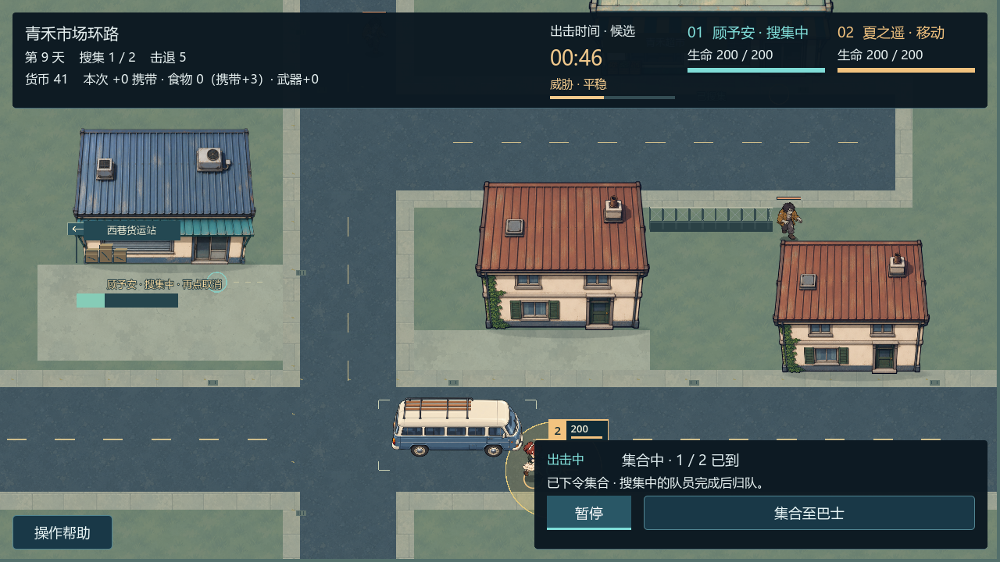
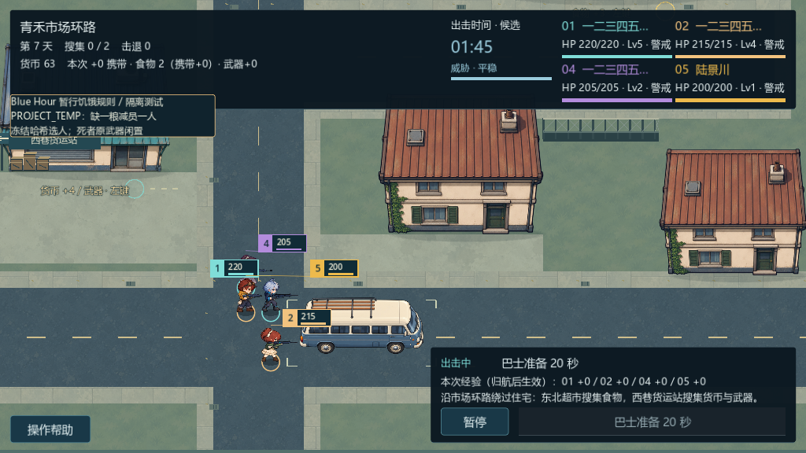
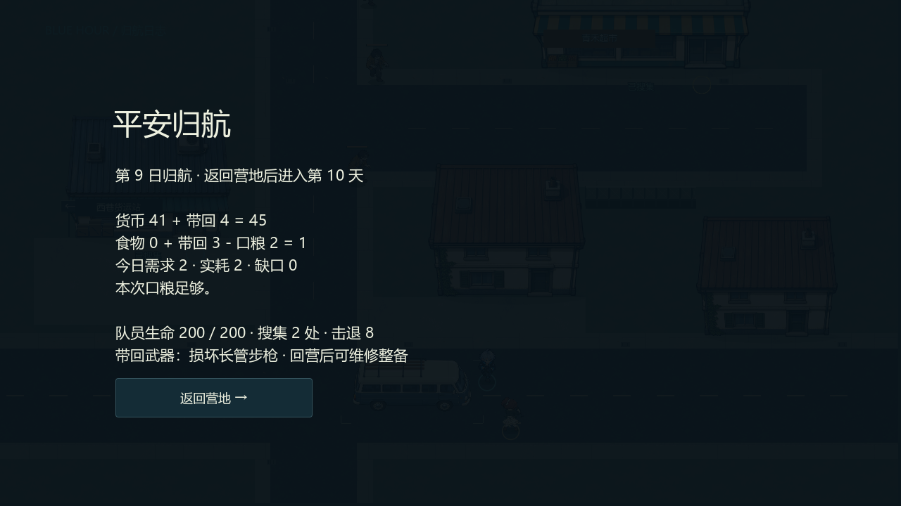

# 巴士发动、集合与归航

M6-WORLD-01增加主路路侧停靠和实际驶入、下车、登车、驶离。进场结束前不接受战场意图；真实全员集合后先冻结原结果再演出，仍需原确认提交。 详见[街区合同](../design/m6-world-01.md)。

M6默认开发试玩使用以下原有巴士与结果流程，按实际存活队员集合；结果预览后须确认保存。 正式生存仍 **NO-GO / BLOCKED**。入口和历史范围见[功能导航](README.md)。

## 发动不是召回

准备完成后可远程点击“发动引擎”，工人仍可继续搜集。发动只启动原流程，不自动改变人员目标。暂停时倒计时、移动、交火和工作都冻结。

等待阶段出现“集合至巴士”后，必须明确点击，或Tab聚焦后以Enter/Space确认，才下达集合路径。暂停下可安排，继续后才实际移动。重复命令不重开引擎；键盘焦点在按钮时Space确认按钮，不同时切换世界暂停。

## 到场人数取实际队员

**历史截图：M5-COMBAT-03（edf9bd9），双人旧HUD。** 一人已到巴士、另一人仍在建筑搜集，实际1/2；不是当前四人界面。

集合只安排合法路径，不传送角色、不自动取消室内搜集。工人完成或手动取消后按最新目标归队。系统以实际位置、可行动状态和集合范围判定到齐；所有实际存活队员都到达才撤离。

111中，援救确认后的原NPC立即加入分母并实际走向巴士。确认阵亡者排除，不能因为原两人已到就提前结束四人行动。尚未完成救援可以撤离，但不会凭空登记新人；当场加入后阵亡只保留真实历史。见[救援规则](sortie-and-scavenging.md)。

**M5-ANIM-01真实四活人任务图**：1024×640窗口、1024×576内容区，长呼号是人工压力测试。五条历史不表示五名同时参战。

## 结果预览与提交

**历史截图：M5-COMBAT-03（edf9bd9）的市场结算预览。** 当前111另有个人XP、Trait、实际死亡和口粮信息；不能用旧图推断当前保存状态。

到齐后冻结本次结果，先展示预览；点击“返回营地”才沿原事务提交携带钱粮、武器、伤情与本人有效成长，并推进日期、处理口粮。重复回调或失败重试不重复给奖励。看到预览不等于营地已提交，失败时应保留现场并按原提示重试。

救援新人当餐不参加原出发名单的口粮；下一趟按全部实际活人计算。真实战斗死亡先排除；隔离生存口粮后的旅程终局与本次成功撤离分别判断，可能出现“任务已撤离、旅程失败”，不能再出击或以旧暂存复活。

## 暂存与退出

Esc菜单可“返回战场并定位巴士”：仅移动镜头，发动、集合和取消工作仍需玩家选择。退出首页不是归航。明确成功的安全暂存可回首页后再续原战场，但不发归航奖励；恢复仍需正常到车和结算。精确收据传输候选待审，失败不能被写成已安全保存，详见[保存边界](save-and-recovery.md)。

集合、人数、食物和死亡政策均为 **Blue Hour PROJECT_TEMP**，不宣称经典Deadly Days V1.7.0F2的完整人数算法或精确值。

[保存与已知恢复限制](save-and-recovery.md) · [营地管理](camp-and-loadouts.md) · [功能导航](README.md)
