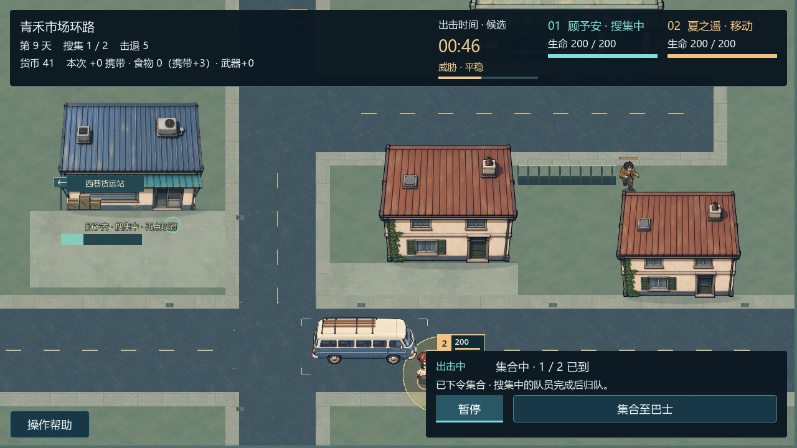
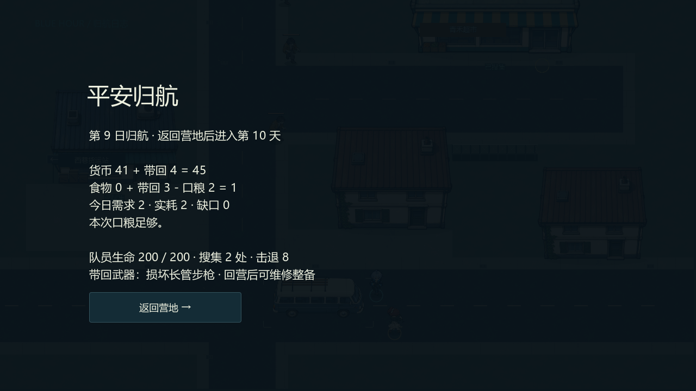

# 巴士发动、集合与归航

内容基线 `edf9bd9`。巴士有准备、发动、等待集合与撤离状态。出击时间和发动倒计时分别显示，不能把“引擎已启动”当成“人员已到齐”。

## 发动与等待

准备完成后可以在远处点击“发动引擎”，也可以在工人搜集时发动。发动只启动原有流程，不自动改变人员目标或召回工人。世界暂停时发动、战斗和搜集计时同样冻结。

进入等待阶段后，按钮变为“集合至巴士”。玩家明确点击它，或用 Tab 聚焦后以 Space/Enter 确认，才安排去往本图巴士集合区域的合法路径。暂停下也可安排；继续后单位才移动。

## 人数是真实位置

M5-COMBAT-03 的正常市场任务中，一名队员已经在巴士旁，另一名仍在搜集，所以显示 **1 / 2 已到**。集合不会把工人瞬移回车，也不会中断当前工作；工人完成或手动取消后按最新集合目标归队。

到场数由实际位置、可行动状态与本图集合范围计算。重复命令不重新启动引擎。所有应集合成员真正到齐后才完成撤离；不透明 HUD 仍会挡住其覆盖区域的地面输入。

## 结算与保存边界

撤离后先展示真实本次结果；点击“返回营地”才将携带钱粮、武器、伤情和行动记录提交一次，并推进日期、处理口粮和写盘。重复回调或重试保存不会重复给奖励。

因此，看到结果预览还不等于营地已经保存。中途退出或停在未回营的结果页不能被当成完成入库。保存失败后的处理见[保存与恢复](save-and-recovery.md)。

以上集合入口和真实人数是 Blue Hour 的项目要求；相关旧本机观察只支持其特定暂停/搜集/发动语义，不是对原作集合人数算法的完整复刻声明。[返回文档导航](../README.md)。
