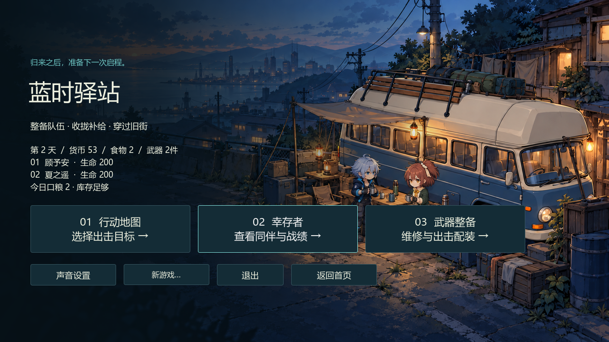
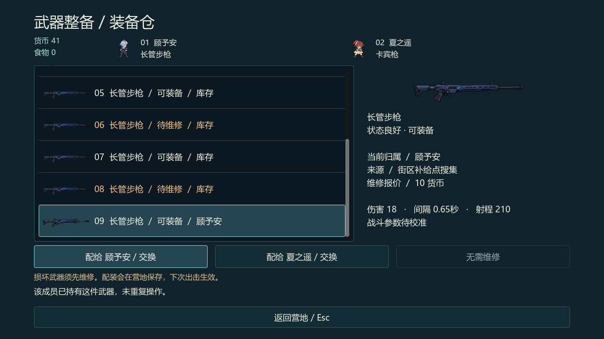

# 营地、历史名册与武器整备

M6默认开发试玩已接入以下营地、成长、训练和装备系统；旧开发入口单独保留，不自动迁移进度。 正式生存仍 **NO-GO / BLOCKED**。入口和历史范围见[功能导航](README.md)。

## 营地设施与身份

111使用原创河岸营地：巴士进入既有任务选择，集合棚或人物打开档案，工坊维修与配装，篝火进行本人Trait训练。设施只是既有业务入口，不另造经济或保存系统。鼠标、Tab/Enter/Space及Esc逐层返回；未确认呼号可继续编辑或放弃，取消不写盘。

**历史截图：M4-03（7ffb937）的双人旧营地入口。** 它不是当前河岸2D营地、当前名册或动画截图；保留用于展示项目演进。

当前名册分别显示存活人数与历史容量：最多四名活人、最多五条历史。真实阵亡后可在后续救援补位；死者仍保留原ID、呼号、普通等级/XP、Trait、训练、死亡及装备历史，不重新编号、不复活。死者档案只读，不能配装或训练，出击和营地人物只取活人。

普通等级/XP/生命与个人Trait等级/进度分开显示；不拿旧行动记录补造XP。1粮换1点本人Trait累计进度的篝火训练须预览、确认并保存，显示下一餐风险，不给全队共享或改变普通XP。所有值为PROJECT_TEMP。

## 实例与本人有效数值

| 枪型 | 基础伤害 | 基础间隔 | 基础射程 | 定位 |
| --- | ---: | ---: | ---: | --- |
| 卡宾枪 | 18 | 0.65秒 | 210 | 较快射击和近距持续输出 |
| 长管步枪 | 32 | 1.30秒 | 315 | 较高单发与更远接敌 |

同一枪型的不同实例可以有不同属性。独立武器等级Lv1/Lv2、普通/稀有品质、词条与幸存者Trait不是同一个成长系统：Lv2伤害×1.10；普通无词条，稀有有一条“延伸瞄具”（射程×1.15）或“轻快机件”（间隔×0.90）。品质本身无额外隐藏倍率，普通人物等级不加枪械伤害。

工坊同时展示枪型基础、实例属性及成员配装后的真实有效伤害/间隔/射程，战斗使用同一数值链。本人射击Trait只影响本人的间隔；比较时固定同一角色等级/Trait、品质/武器等级和敌人条件。

**历史截图：M5-COMBAT-03（edf9bd9）的旧配装页。** 此时两枪参数尚未区分，也没有后来武器品质、等级或词条。当前真实基础值以表格和游戏现页为准，不能从旧图推导。

## 搜得、维修与唯一归属

111现金搜集完成时冻结损坏长管实例属性，成功归航才入库；初始和救援自带枪为Lv1普通无词条。维修仍需原确认及10币，只改损坏状态，不重抽等级、品质或词条。配给闲置枪时旧枪回库；配给另一人持有的实例时交换，同一件不能被两人占用。

维修、配装、改名和训练走原营地编辑事务，保存失败按原提示重试。死亡装备历史记录当时真实实例，历史不等于当前占用；现有死亡库存政策保持，不重复发枪。尚无完整品质池、制作台、洗词条、磨损、弹匣或换弹。

保留[历史行动记录截图](../screenshots/survivor-journal.png)（M5-03／73fa2ed），其当时没有经验和训练，不能冒充当前成长页。当前四活人显示见[巴士文档](bus-evacuation.md)。

人数、属性、概率、维修和死亡归属都是 **Blue Hour PROJECT_TEMP**；经典版历史上存在品质/独立等级，不证明本机V1.7.0F2精确公式或本项目这些数值。

[出击搜集与救援](sortie-and-scavenging.md) · [保存边界](save-and-recovery.md) · [功能导航](README.md)
