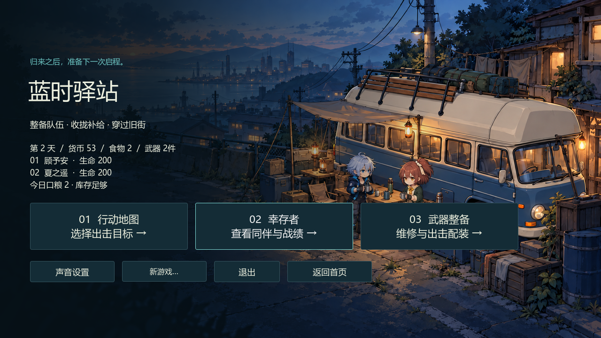
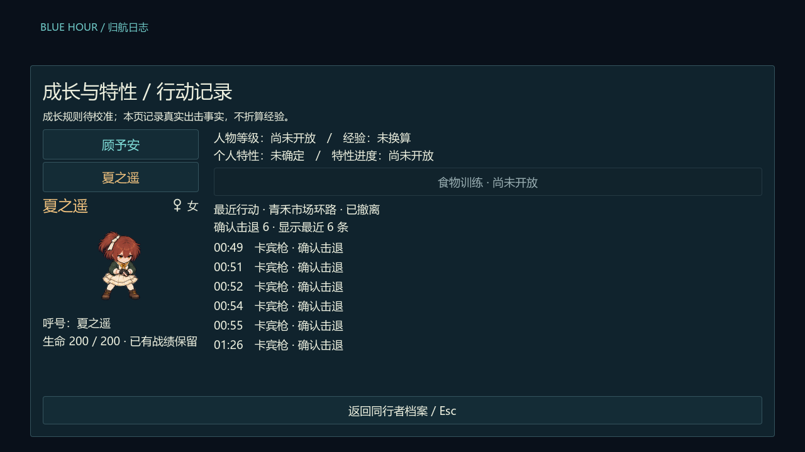
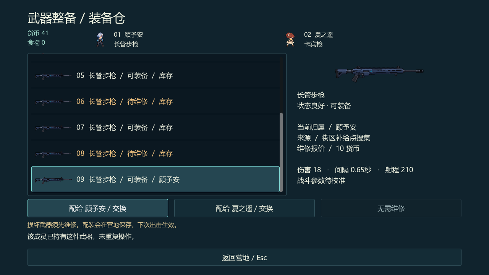

# 营地、身份与武器整备

内容基线 `edf9bd9`。当前正式旅程使用两名固定角色：顾予安（男）与夏之遥（女）。正式身份和性别来自定义，玩家可保存自己的呼号；旧英文呼号不会被强制覆盖。

营地图来自 M4-03 的历史初始状态，用于展示入口与原创角色，不表示本轮又推进了一局。

## 档案与行动事实

幸存者页面显示实际生命、当前状态、装备及个人出击/击退/受伤记录。修改呼号只改呼号；从档案进入该成员配装后返回，仍保留当前选中成员。

行动页来自 M5-03 的实际任务，按成员列出确认击退、当时武器和发生时间，重启后保留。它**不折算经验**。等级、经验、特性效果与食物训练尚未开放，不给旧任务补造经验或升级回血。

## 实例、维修与配装

武器按实例管理，包含状态、来源和唯一归属。当前有卡宾枪与长管步枪；普通任务的损坏样本在成功归航并返回营地后才进入库存。

先确认维修，再配给成员。配给闲置武器时旧物回库；配给另一人持有的武器时交换，两人不会同时占用同一件实例。取消维修不扣款，确认配装和维修是营地保存边界，保存失败可安全重试。

当前维修 10 货币以及两枪 18 伤害、0.65 秒间隔、210 射程是 `PROJECT_TEMP`，不代表原作所有武器相同，也不是最终平衡。

## 食物与未开放规则

归航按实际带回的食物和当前日耗结算。食物不足会显示缺口及未应用的候选结果；此快照没有启用饥饿扣血或正式永久失员。现有 active/down 生命状态不等同于已经实现永久死亡。

名册、钱粮、库存、配装与行动记录一起受 v5 保存校验；声音偏好单独保存。更多边界见[保存与恢复](save-and-recovery.md)。[返回文档导航](../README.md)。
