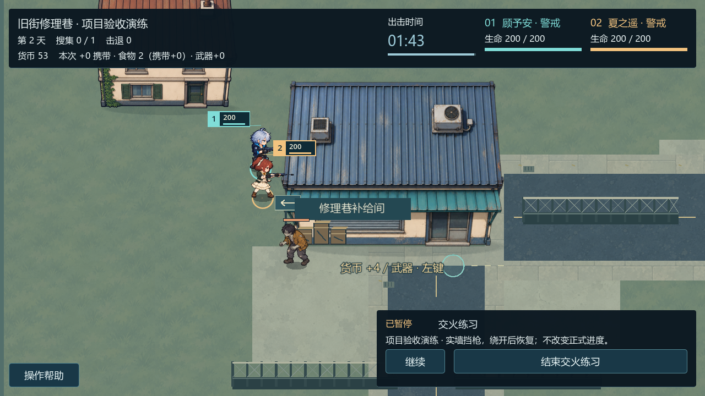
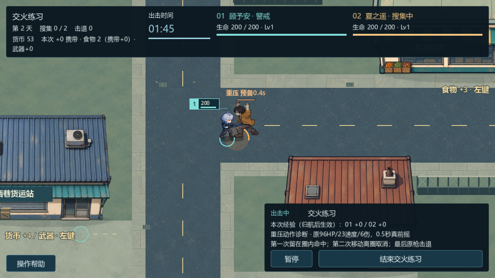
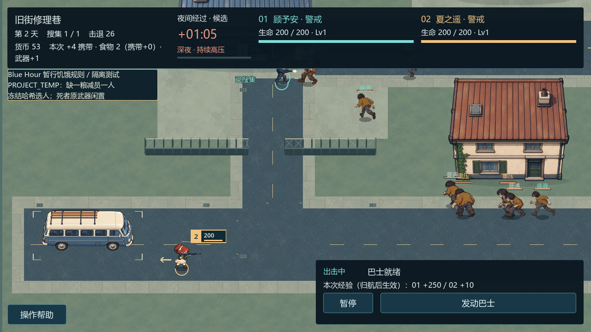
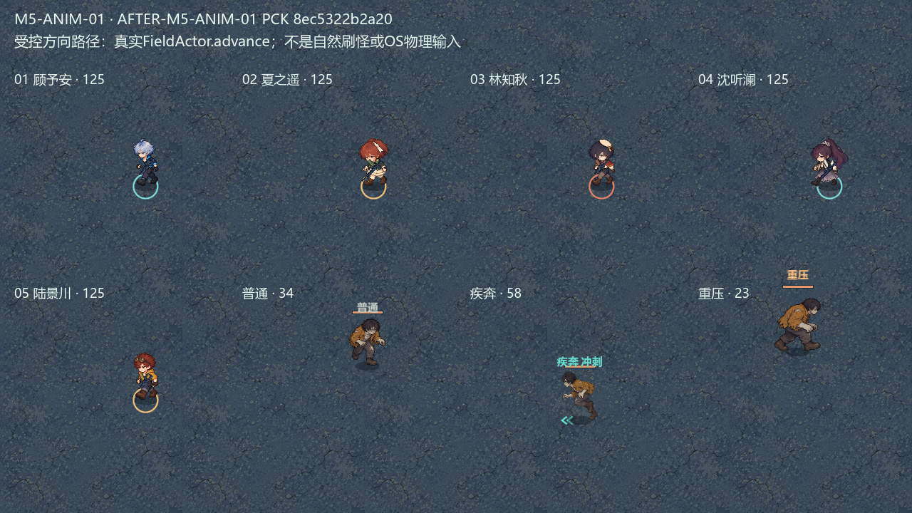

# 战斗、视线与夜间威胁

当前含 **ANIM-02＋普通感染者V1** 表现候选。普通默认仍保留原双人入口；以下新增敌种、成长和多人成果属于[显式111隔离原型](README.md)。正式生存发布 **NO-GO / BLOCKED**，不因战斗或动画阶段通过而解除[保存门禁](save-and-recovery.md)。

## 自动交战与墙体

成员在目标可攻击、脚底距离满足武器射程且LOS合法时自动射击。选敌和提交射击共用判定：屋顶淡化不代表前墙可穿透，被挡的近敌不会永远占住目标。敌人沿真实导航接近，不传送穿墙；移动绕角、手动取消搜集及及时撤离都是应对方法。

**历史截图：M5-COMBAT-03（edf9bd9），隔离LOS测试站位。** 使用真实战斗组件，但不是普通出生位置，也不是当前敌种或动作展示。

## 三类敌人

| 类型 | 当前PROJECT_TEMP参数 | 行为和可辨动作 |
| --- | --- | --- |
| 普通 | 54HP、34速度、4伤 | 原近战与追击；无新增前摇。V1五源三镜像、六姿态拖步、接触/恢复、受击和倒地，数值与命中时点不变。 |
| 疾奔 | 36HP、34→58速度、4伤 | 可见、可达且LOS合法目标进入95距离时加速，目标失效后恢复常速；独立前倾步态和冲刺提示。 |
| 重压 | 96HP、23速度、6伤 | 进入脚底28范围后停步预备0.5秒，再检查原目标；移开、遮挡或击退可取消，不立即换人命中。举臂与预警对应真实前摇。 |

暂停冻结移动、冷却和重压前摇；重击只在实际合法时点扣血。类型、HP、目标、状态和剩余计时沿原[暂存链](save-and-recovery.md)保存，受已知哈希拒绝限制。未加入Boss、毒云或远程钩子。

**M5-ANIM-01受控真实实战图**：用原伤害与范围链展示前摇，不是自然难度统计。显示留距不扩大实际脚底安全范围。

## 时钟与夜间

| 阶段 | 出击经过时间 | 名义生成间隔 |
| --- | --- | --- |
| 平稳 | 0秒起 | 7秒 |
| 暮色 | 70秒起 | 5秒 |
| 夜间 | 105秒起 | 3.5秒 |
| 深夜 | 140秒起 | 2.5秒 |

暮色开始混合疾奔，夜间与深夜可出现重压。仍由同一真实刷怪链检查可走、可达、屏外及远离队伍的出生位置；活敌上限24，无合法位置或满额时跳过，暂停不欠补刷。计时归零后仍可发动和集合，没有新增强制失败或自动召回。

**M5-ANIM-01自然修理巷任务图**，按真实时钟进入夜间，未强制出生类型。少量样本和零伤归航都不能证明整体压力已平衡，BALANCE-FOLLOWUP仍保留。另保留[旧市场夜间图](../screenshots/night-pressure.png)（M5-COMBAT-03历史版本）。

## 两枪、人物与动作

卡宾18伤/0.65秒/210距，长管32伤/1.30秒/315距；品质、武器等级、词条和个人Trait各自派生有效值。比较枪械必须固定本人普通等级、Trait、实例条件、敌人、距离与LOS，不能把成员加成当成枪型差异，详见[配装数值](camp-and-loadouts.md)。

五身份有八向移动与瞄准，移动开火保持步态，受击、死亡和局部武器层已接入；三敌种有独立姿态，部分左向镜像、过渡共帧、离散转身及贴身遮挡仍是原型限制。不是最终动画美术签核。

普通感染者保留[ANIM-02](../design/m5-anim-02.md)的方向滞回、短停相位和平滑贴身偏移，使用[V1映射](../design/m5-art-infected-01.md)；幸存者与另外两敌种保持原资源和枪口几何。新轮廓不解决逻辑同点穿叠；Mac受控画面不等于Windows或物理显示验收。

[M5-CONTACT-01](../design/m5-contact-01.md)在逻辑层增加20px脚点分离、追击留距及有限队友让位，保留28px近战和既有数值。移动会绕过可避开的角色占位，紧密包围或无可让位空间时允许阻塞；2.5D身体前后遮挡仍正常存在。本候选先交Mac证据，Windows和物理显示未验。

**M5-ANIM-01受控方向展示**，不是自然刷怪或OS物理输入验收。全部数值、名称和素材为本项目 **PROJECT_TEMP**；历史官方消息不等于本机原作精确验证，不能标成新增LOCAL_VERIFIED。

[出击与救援](sortie-and-scavenging.md) · [巴士撤离](bus-evacuation.md) · [功能导航](README.md)
