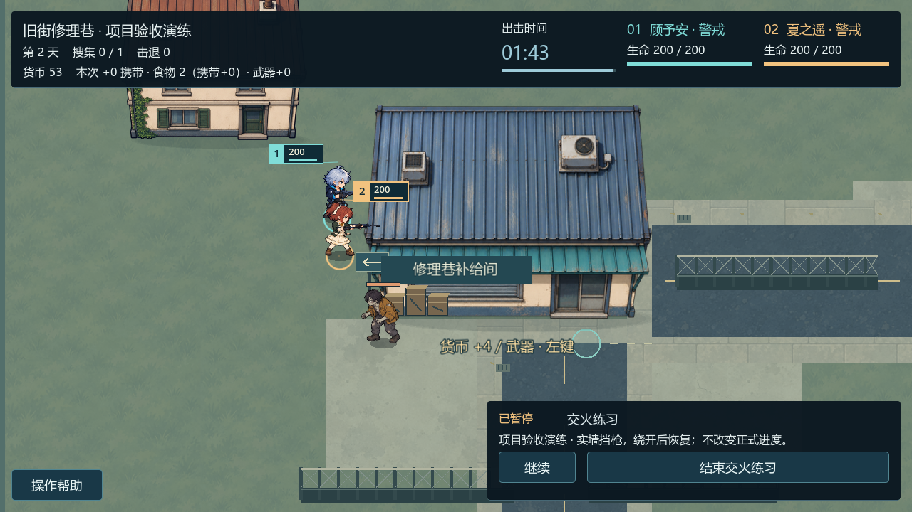
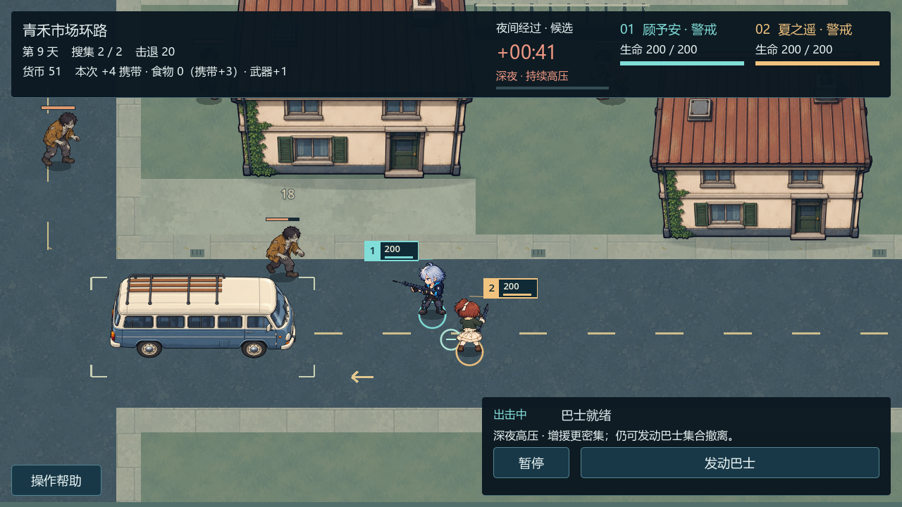

# 战斗、视线与夜间压力

内容基线 `edf9bd9`。敌人经过真实寻路接近可攻击成员，进入合法近战距离后实际扣除生命；队员在武器规则允许时自动开火。生命、击退与行动记录来自同一实际攻击链。

## 墙体与合法开火

建筑实体会挡住枪线。选敌和提交射击共用合法性判断，被挡的近敌不会永久占住目标；移动绕到墙角的合法角度后可重新开火。屋顶为了看清队友而淡化，不会把前墙也变成透射区域。

这张来自 M5-COMBAT-03 的**隔离测试站位**，使用实际场景和攻击系统，画面也标明项目验收演练。它展示墙体判定，不代表普通敌人在该位置随机出生。

## 青禾市场的短视距侧路

货运站附近采用原创地形候选：西侧敌人先沿前墙寻路，再绕东南墙角靠近驻守者。守卫长时间不调整位置可能遭到近战；及时移动、手动取消未完成搜集或发动后明确集合撤离，能够降低损血。

敌人仍遵守原安全生成规则：候选点必须可走、可达、屏外并留有余量，远离可见活动队员，且与现有敌人保持分离。没有为墙角场景增加贴身生成、传送或穿墙攻击。

这一风险仍然轻微，并依赖配装、站位与反应时机。取消工作会放弃尚未完成的本次奖励；它可以减少生命损失，不表示所有代价都更低。现有配装常能提前击退敌人，不能把少量验收场次解释为整体难度或受伤概率已经定版。

## 逗留和增援

普通任务的同一时钟驱动当前候选阶段：

| 阶段 | 出击经过时间 | 名义生成间隔 |
| --- | --- | --- |
| 平稳 | 0 秒起 | 7 秒 |
| 暮色 | 70 秒起 | 5 秒 |
| 夜间 | 105 秒起 | 3.5 秒 |
| 深夜 | 140 秒起 | 2.5 秒 |

这些阈值和间隔均为 `PROJECT_TEMP`，不是原作常量。活敌上限 24，满员或无合法点时跳过；暂停不累计补刷欠债。倒计时归零后仍能发动、集合和撤离，没有新增强制失败或自动召回。

这张为正常市场按自然时钟进入深夜的真实画面。增援更密不保证每局都掉血，图中的生命仍是实际结果。

原作精确射程、衰减、障碍类别、夜间敌种/曲线等仍有 `UNKNOWN`。Blue Hour 当前枪械、敌人和威胁参数保持既有候选；旧 `LOCAL_VERIFIED` 观察和 `OFFICIAL_HISTORICAL` 新闻都不能替代这些缺口。

[撤离方法](bus-evacuation.md) · [返回文档导航](../README.md)。
