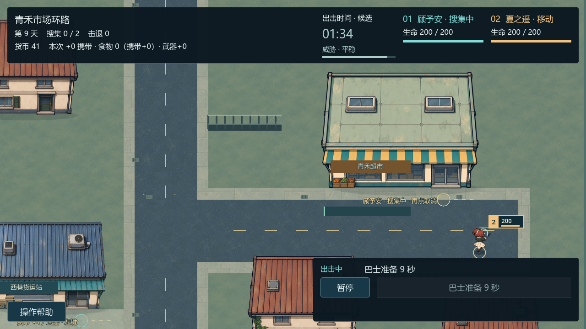
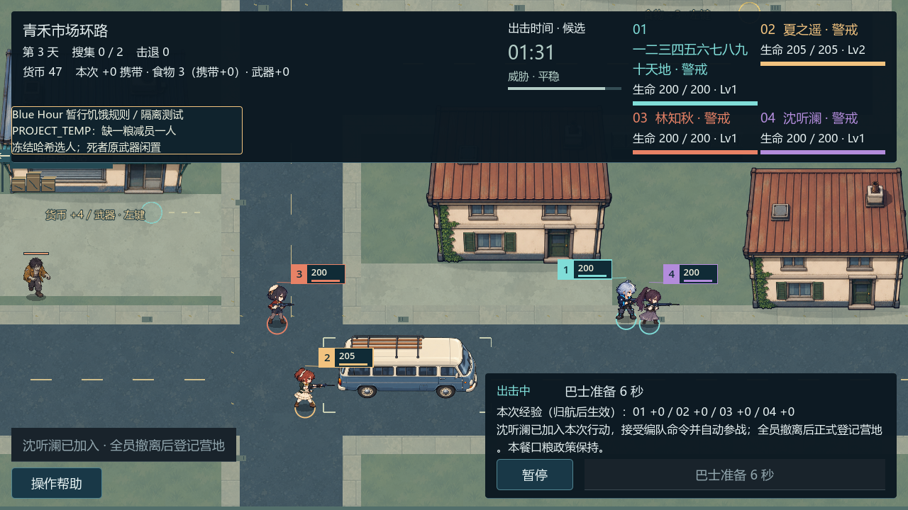

# 出击、搜集与救援

本文描述截至 **M5-ANIM-01** 的已验收开发原型。普通默认入口保留双人旧旅程和基础武器实例、维修与配装；候选救援、四活五历史、成长、武器品质/等级/词条及特殊敌人需[显式111隔离入口](README.md)。正式生存仍 **NO-GO / BLOCKED**，原因见[保存限制](save-and-recovery.md)。

## 选图与下令

从营地巴士进入任务选择。旧街修理巷与青禾市场环路使用同一出击系统，各有道路、建筑门口和绕行路线；这是原创固定地图，没有完整随机城市。

左键可通行地面安排编队移动；WASD平移镜头，滚轮缩放。无控件焦点时空格暂停；Tab/Shift+Tab切换控件，Enter/Space确认。暂停下可下令，继续后才移动。Esc打开暂停菜单，帮助和确认框优先关闭；不透明HUD会阻挡地面操作。

## 派工与真实搜集

点击可搜集建筑，系统选择一名可行动队员走到门口。进入室内后该成员隐藏，其他人继续移动、警戒与自动开火；没有新增室内动画。

再次点击同一建筑可取消，保留该点已推进的进度，但不发尚未完成的奖励。改派另一搜集点沿原单工人规则交接。地面命令或巴士集合不会自动取消工人；完成或手动取消后，他会按最新目标归队。本人搜集Trait只影响实际执行者，不给全队共享加速。

现金、食物和武器先记为当次携带，真实撤离并确认返营后才入账。在111原型中，现金点完成时冻结损坏长管实例的等级、品质及词条，预览、维修或重开不重抽。具体实例差异见[营地与配装](camp-and-loadouts.md)。

**历史截图：M5-COMBAT-03（edf9bd9），非当前动作/成长版本。** 展示真实市场搜集与室外警戒；旧武器值及旧HUD不能用于判断当前实例属性。

## 救援与当场入队

显式111旅程的救援任务可能遇到林知秋、沈听澜或陆景川之一。每趟只冻结一个目标；多个候选不等于同图多目标。已经加入或阵亡的身份不会重复出现，读取途中暂存不重新选择目标。

点击目标或援救按钮，由一名存活、可见且未在室内搜集的队员走近援救。达到范围才累计10秒；世界继续运行，暂停则冻结。取消、改令或援救者失去资格会中止当前指派，沿原状态机保留已有部分进度，不凭空招募。

唯一入队记录获原保存链确认后，**原NPC当场成为正式队员**，参加移动、自动战斗、受伤、个人成长和巴士集合。保存失败会冻结并要求重试，不能先生成一个未保存的活人。成功撤离后才登记为营地活人；途中确认阵亡保留历史，不在返营时复活。

**历史截图：M5-RESCUE-02，已验收Windows包原生viewport。** 沈听澜已当场成为第四名队员；长呼号是人工输入压力测试，不是真实姓名。图中是旧动作和旧HUD，历史名册规则仍为当时版本，不能冒充当前M5-ANIM-01画面。

当前111继承四名存活上限和五条历史容量。四活人时没有新名额；真实阵亡并归航保存后，可以在下一趟救援剩余候选补位，形成五历史、四活人。死者身份、普通等级、Trait、装备历史及死亡记录保留；不复用ID、不重复发枪，也不开放五名同时存活。

救援当餐只计原出发名单中的战后存活者，新人从下一餐参加；下趟全部实际活人一同出击。人数、10秒、奖励及口粮政策均为 **Blue Hour PROJECT_TEMP**，不是经典Deadly Days V1.7.0F2精确规则。

[巴士撤离](bus-evacuation.md) · [战斗与夜间](combat-and-night-pressure.md) · [功能导航与证据等级](README.md)
