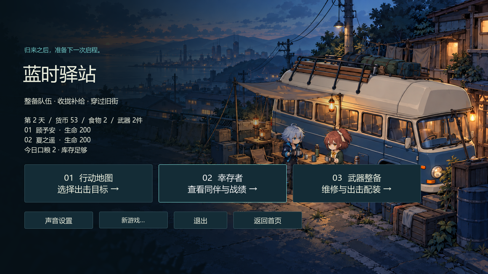

# 精选真实游戏截图与版本

全部为真实Blue Hour viewport原PNG，不是生成的游戏展示图，不含Deadly Days画面、原作素材或研究截图。本轮仅恢复/补充既有原件，未新录、未改画、未抹除水印或私人元数据。四张M5-ANIM-01图片保持原字节。

历史图用于展示玩法和项目演进；其旧HUD、动作、武器值、人数与未开放说明**不代表当前原型**。当前功能以[五篇独立Feature](../features/README.md)为准。精确收据传输候选待审，正式生存NO-GO/BLOCKED。

| 图片 | 捕获版本 | 实际条件与限制 |
| --- | --- | --- |
| [home.png](home.png) | M4-03 / 7ffb937 | 历史首页；不是本轮重新运行 |
| [camp.png](camp.png) | M4-03 / 7ffb937 | 历史双人旧营地入口；不是当前河岸2D营地 |
| [market-scavenging.png](market-scavenging.png) | M5-COMBAT-03 / edf9bd9 | 正常市场搜集；旧动作与旧参数 |
| [loadout.png](loadout.png) | M5-COMBAT-03 / edf9bd9 | 旧配装页；当时两枪未区分，无当前品质/等级/词条 |
| [bus-gather.png](bus-gather.png) | M5-COMBAT-03 / edf9bd9 | 普通市场真实1/2到场，工人继续搜集 |
| [evacuation-result.png](evacuation-result.png) | M5-COMBAT-03 / edf9bd9 | 历史归航预览；尚需返回营地提交 |
| [survivor-journal.png](survivor-journal.png) | M5-03 / 73fa2ed | 历史行动记录；当时无经验/训练 |
| [los-wall-demo.png](los-wall-demo.png) | M5-COMBAT-03 / edf9bd9 | 隔离LOS演练站位，不是普通出生 |
| [night-pressure.png](night-pressure.png) | M5-COMBAT-03 / edf9bd9 | 旧自然市场深夜，不证明难度已平衡 |
| [rescue-join.png](rescue-join.png) | M5-RESCUE-02 | 已验收Windows包原NPC加入四人行动；旧动作/HUD，呼号为人工压力测试 |
| [eight-directions.png](eight-directions.png) | M5-ANIM-01 | 受控八方向FieldActor路径，不是自然刷怪 |
| [night-enemies.png](night-enemies.png) | M5-ANIM-01 | 自然修理巷真实时钟与刷怪 |
| [heavy-windup.png](heavy-windup.png) | M5-ANIM-01 | 受控真实重压前摇，不是自然难度统计 |
| [four-survivors.png](four-survivors.png) | M5-ANIM-01 | 真实四活人HUD；1024×640窗口/1024×576内容，人工长呼号 |

## 原始内容身份

| 文件 | 字节 | SHA256 |
| --- | ---: | --- |
| home.png | 1325899 | `0acac7d6b477020f329a987189b143a71985f1c252d84e68723bcc353d1046a5` |
| camp.png | 1207936 | `8706931b894c7f7b75f4f081d14bc029b7f272800a40c2bdfd6ba2b78c0683e7` |
| market-scavenging.png | 979558 | `99d263764627aa8062624a04aa7ea070e7aebead76820c6b21eeca9b5b56f1ec` |
| loadout.png | 148234 | `6199019bc222efe8907b7c2d702e6cdceeb213691aa098bdf0e7c56cce2cede1` |
| bus-gather.png | 957513 | `dee3d53da65b1c7b80e6cabb3febddd7227147434fefedba8063f226996e06be` |
| evacuation-result.png | 314487 | `3e94f64bbc503d9475dfdc8f91c8417e7fc5f9a9bf1146c361a2cf472a9e035e` |
| survivor-journal.png | 132789 | `7cc65ff0fd78d9e2e097b731a7c02be1582510fc527decec09a4cdf659598943` |
| los-wall-demo.png | 912341 | `10cbfb484947740c2f51a9a99a205e3ad26bc93e775707b82c45be9bdd58fc25` |
| night-pressure.png | 961163 | `01332e1bb0937ae523fff8655b09fe7bd61de5f9648896772f914fab261f39b7` |
| rescue-join.png | 879552 | `ebc64e4e5535785828353f4f62254cbc7c72e327bad52f42b5acabbac4a47bc7` |
| eight-directions.png | 549127 | `6f38d2bc856305902b30dd9ef6de308b3c78ab028e904d3ecfda312b1d617bfe` |
| night-enemies.png | 926528 | `d2c763c1048bb1b10774bf50b69f63172c8bb17fc3e11d455b664e02fb93bfe7` |
| heavy-windup.png | 661525 | `4c48ff2cfca0087111442615d5e6bf3cf179409ff9dbecbeaf0258b3383fd08b` |
| four-survivors.png | 668675 | `83110566c95240d49e8ba8482908a6e6748b4cfd8ef6ac697b9a724300364532` |

原九张历史图从既有公开根a248d30逐字节恢复；救援图与已验收M5-RESCUE-02审阅配方SHA一致，未公开其测试档/录像。当前四张来自已审M5-ANIM-01原型。画面只证明标注场景，不证明OS物理输入、最终美术或生产可靠性。

M4-03 / 7ffb937历史图，非当前2D营地。

[返回文档导航](../README.md)。

## M6-WORLD-01 Windows V1

原创八类建筑的真实Godot画面，Windows Compatibility。总览未推进模拟；街道/巴士图来自最终PCK的1×自动输入流程，非概念图或物理键鼠证据。

- [world-01-overview.png](world-01-overview.png) · SHA256 `6120e5b9bae347b7e41964f3fc5cb6a85b29f0d94ec2c4f9ee7add1da6de9c0e`
- [world-01-street.png](world-01-street.png) · SHA256 `b3ad2c2448ab0c7c4d14f55831d4cd7a72ebfdd2919102530b09ae1641c0986e`
- [world-01-bus.png](world-01-bus.png) · SHA256 `41133011c0479b3e0730fe7fa4d091e5033866a6161dd7c7ba171179a84db076`

## M6-WORLD-02 Windows

以下均为最终PCK的原生Godot画面，不是概念图。local为只读V3场景、隐藏HUD、zoom0.70；street为1×实际移动/搜刮后的轮廓遮挡；overview为明确标注的只读布局预览，不能与正常相机比例混比。物理键鼠和显示FPS未验。

- [world-02-local.png](world-02-local.png) · SHA256 `f3a70d553cd7e557e817f0572f9082c7b931d30846fd27bcd5149f40509db927`
- [world-02-street.png](world-02-street.png) · SHA256 `eb643e490942c31f0e6f4564c90c46506013f28780bf528e4ed3fc5bd60c8526`
- [world-02-overview.png](world-02-overview.png) · SHA256 `59b219cd4952cf9bfca5da33b17c96e88072bff381cb574e3d98308759f27ac7`
