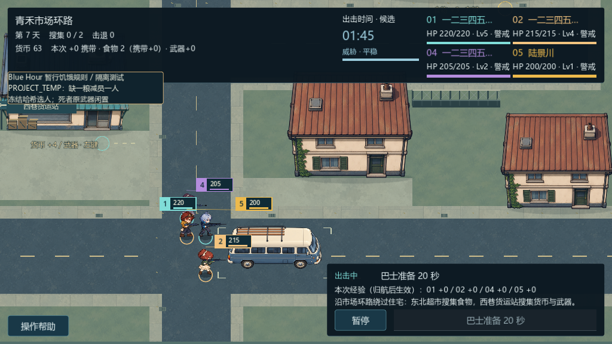

# 精选真实截图

全部为已验收Blue Hour动画原型的真实Godot viewport原PNG，未改画、未混入原作媒体。候选运行源码/资源与该已验收版本一致。

| 图片 | 条件 |
| --- | --- |
| [八方向](eight-directions.png) | 固定路径的受控FieldActor展示，五身份与三敌种；不是自然AI危机。 |
| [夜间敌种](night-enemies.png) | 修理巷真实时钟、自然刷怪和任务，未强制出生类型。 |
| [重压前摇](heavy-windup.png) | 明确受控实战，原真实前摇/伤害链；不是正常难度统计。 |
| [四人HUD](four-survivors.png) | 1024×640窗口、1024×576内容区，实际四活人；长呼号是输入压力测试，不是真实个人姓名。 |

录像、原始测试档和私有证据未发布。画面只证明当前原型展示，不消除已知哈希拒绝、贴身遮挡或正式发布限制。
